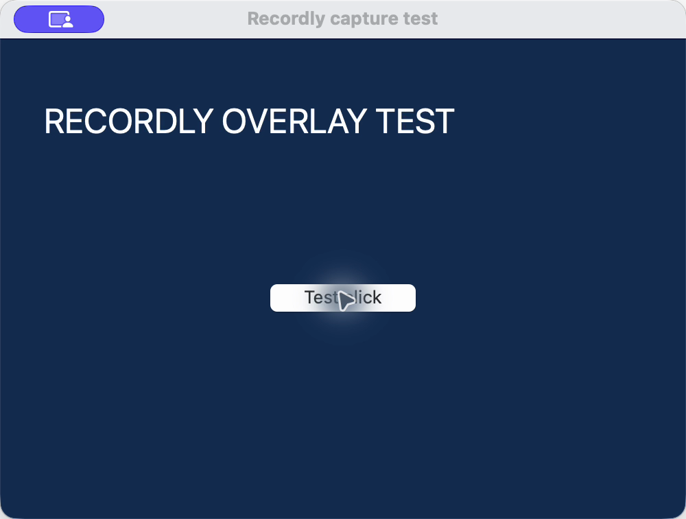
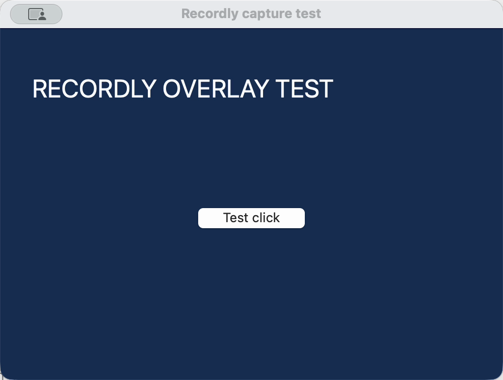

# Hide the Codex overlay in recordings

The macOS recording setting **Hide Codex overlay in recordings** excludes the Codex Computer Use helper from the captured video. It is off by default and applies to new recordings. The overlay remains visible on the user's screen.

**Implementation.** Recordly's window mode captures a display and crops it to the selected window. Selecting a window therefore does not isolate it from another application's overlay. This change adds an exclusion to the ScreenCaptureKit filter used by both display and window recording.

The dedicated helper has bundle identifier `com.openai.sky.CUAService`; its observed cursor window is named `Software Cursor`. The main Codex application, `com.openai.codex`, is not excluded. Recordly's existing HUD exclusion is preserved. The renderer passes only the `hideCodexOverlay` boolean, not arbitrary process IDs.

Two changes are needed in the native recorder:

1. When enabled, enumerate shareable content with `onScreenWindowsOnly: false`, so an existing helper can be excluded before its overlay becomes visible. The target recording window must still satisfy `isOnScreen`.
2. Extend the existing 500 ms window validation loop to display recordings when this option is enabled. Refresh the filter when excluded application IDs change or the selected window moves to another display. Display recordings with the option off do not start this loop.

The preference uses the existing recording settings store. Older settings default to `false`. The recording HUD reads the current preference immediately before native capture starts, so changing it in Settings also works while the HUD remains mounted. Pausing and resuming keep the existing recording and timestamp logic.

**Files.** The setting lives in `src/components/video-editor/dashboard/DashboardSettings.tsx`. `src/hooks/useScreenRecorder.ts`, the Electron preload/types, and `electron/ipc/register/recording.ts` pass it to `electron/native/ScreenCaptureKitRecorder.swift`. `electron/ipc/register/settings.ts` and `electron/ipc/settings/recordingPreferencesStore.ts` handle persistence.

**Test environment.** Tested on 2026-10-05 with macOS 26.6.2, Apple Silicon (arm64), Codex 26.930.31730, and Recordly 1.4.0 based on fork revision `4fda917a`. Native helpers were compiled for arm64 and x86_64; runtime capture was tested only on arm64.

**Ablation results.** Static variants construct the exclusion only at capture startup. The synthetic fixture is a colored overlay window used to control process and window timing; fixture results are separate from real Codex results.

| Case | Variant | Result |
| --- | --- | --- |
| Real Codex cursor visible during recording | Original capture | Cursor and glow appear in the video. |
| Real cursor exists before capture starts | Static exclusion | Exclusion works. |
| First real cursor appears after capture starts | Static, visible-content enumeration | Cursor can enter the video. |
| Fixture helper exists but its window is hidden at startup | Static, visible-content enumeration | The fixture is missed when shown later. |
| Same hidden fixture | Static, all-window enumeration | The fixture stays excluded throughout the tested clip. |
| Fixture process starts after capture | Static exclusion | The fixture remains visible after it appears. |
| Same late fixture process | Dynamic exclusion | The fixture is removed; one run retained 13 frames, about 0.217 s at 60 fps. |
| Real Codex Computer Use | Final implementation, window recording | Cursor and glow are excluded in the tested capture. |
| Real Codex Computer Use | Final implementation, display recording | Cursor and glow are excluded in the tested capture. |

The 500 ms polling interval is not a guaranteed removal deadline: enumeration, scheduling, and filter updates also take time. A helper created after capture begins can appear briefly. Starting Computer Use before the recording avoids that startup case in the tested environment.

**Verification status.** The full Vitest rerun passed: 168 files, 1,465 tests. One existing source-string assertion failed on the first run because the native validation loop was refactored; its expected expression was updated before the passing rerun. Three focused preference/store tests and three browser UI tests passed. Type checking, locale consistency, and `git diff --check` passed. Browser tests cover preference persistence, the macOS-only UI, and fresh option forwarding; they do not run the packaged native recorder. Real capture clips provide separate native evidence.

**Packaged application acceptance.** An isolated arm64 app was built with Electron 43.4.1 (within `^43.1.0`), verified with strict ad-hoc signature checks, and opened on the desktop. Its setting defaulted off and persisted `true` after enabling. It uses a separate bundle ID/data directory and disables updates. App-level recording awaits macOS screen-recording authorization for this separate application. Direct final-helper pause/resume/stop and saved-video decoding passed; these do not replace the pending app-level recording or audio checks.

**Recorded evidence.** These are saved-video frames from a controlled test window (not live screenshots). The before frame contains the virtual cursor and glow; the after frame is from the final compiled recorder.

**Manual reproduction.**

1. Build the matching native helper and application, for example with `npm ci` followed by `npm run build:mac`. A renderer-only rebuild is insufficient for the Swift change.
2. Open Settings → Recording. Leave **Hide Codex overlay in recordings** off for a baseline, then enable it for a comparison recording. Select a simple test window.
3. Have Codex Computer Use click and move over the test window. Inspect the saved recording, rather than judging from the live screen; the live overlay is expected to remain visible.
4. Repeat with an entire display selected. Confirm that the target content is captured and the main Codex window remains visible if it is inside the captured area.
5. Exercise both startup orders: Computer Use active before recording, and its helper first appearing after recording starts. Inspect initial frames in the latter case.
6. Pause/resume and stop through Recordly, then check playback and any enabled audio tracks. Verify these in the packaged app before accepting it for regular use.

**Evidence and limits.** Local clips and fixture runs are under `work/ablation/`. The real capture stills are `real-baseline.png`, `real-final.png`, and `real-display-crop.png`; the last is cropped from a display recording. Fixture comparisons are `late-static.png`, `late-dynamic.png`, `hidden-static-visible.png`, and `hidden-static-all.png`. In the hidden-fixture comparison, the colored fixture is the measured overlay; a real Codex cursor elsewhere in that frame is not evidence about the fixture filter.

The feature is macOS-only and depends on the observed helper identity. The x86_64 build has not been run on Intel hardware. macOS may retain its own gray privacy or screen-sharing indicator. This filter does not remove pixels from existing recordings or promise zero transient frames when a new helper starts late.
